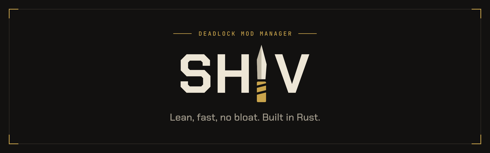

<p align="center">
  
</p>

<p align="center">
  <a href="LICENSE"></a>
  
  
  
</p>

**Shiv** is a small, native mod manager for [Deadlock](https://store.steampowered.com/app/1422450/Deadlock/).
It has no webview and no Electron or Tauri layer, so it stays light on memory and
scrolls smoothly even on Linux.

It exists because the standard manager renders through a web engine and idles at
gigabytes of RAM. Shiv does the essentials and nothing else.

## Features

- **Browse** the Deadlock Mods catalog with search, sorting, category filter, pagination,
  thumbnails and a detail page with an image gallery.
- **Install** mods from zip, rar, 7z and multi-VPK archives, with a file picker when a
  mod offers several downloads.
- **Enable and disable** mods. A mod is just a VPK in `citadel/addons`, so toggling is
  a rename and load order never changes.
- **Fix broken mods.** A health check finds truncated, partial or duplicate VPKs, and a
  repair step fixes mods broken by game updates, with a preview before anything changes.
- **Launch** the game through Steam. The health check runs first and warns you instead
  of blocking you.
- **Crosshairs** with a live preview, applied as `citadel_crosshair_*` values.
- **Performance presets** (pretty, balanced, sweaty, potato) and per-setting editing,
  written to the game's `GameInfo` file.
- NSFW mods are blurred until you turn them on, and that setting resets every session.

Notes on the toolkit choice and repair port are in [`docs/`](docs/).

## Install

> Pre-built packages are being set up. Until the first release, build from source.

## Build from source

You need a recent stable Rust toolchain (edition 2024) and the usual Linux
windowing libraries (Wayland or X11, `libxkbcommon`, `fontconfig`).

```sh
git clone git@github.com:Siebe-Uy/shiv.git
cd shiv
cargo run --release -p shiv-ui
```

Run the tests:

```sh
cargo test --workspace
```

Shiv locates Deadlock through your Steam library automatically.

## Project layout

| Crate | Purpose |
|---|---|
| `shiv-ui` | The Slint application: screens, state and thumbnail pipeline |
| `shiv-core` | Game detection, install, enable/disable, health checks, launch, crosshair, performance |
| `shiv-api` | Client for the [Deadlock Mods API](https://api.deadlockmods.app) |
| `shiv-repair` | Content repair for VPKs broken by game updates |
| `vpkmanager`, `vpk-parser`, `kv-parser`, `source2-model` | VPK, KeyValues and Source 2 parsing, copied from the Deadlock Mod Manager |

Brand assets live in [`style/`](style/README.md).

## Credits

Mod data comes from the [Deadlock Mods](https://deadlockmods.app) API, which mirrors
[GameBanana](https://gamebanana.com). The VPK and Source 2 crates derive from the
[Deadlock Mod Manager](https://github.com/deadlock-mod-manager/deadlock-mod-manager)
and bundle code under their own licenses (see `LICENSE-ValveResourceFormat` and
`LICENSE-vpkmerge` in `crates/`).

Shiv is not affiliated with Valve.

## License

Shiv is free software under the [GNU General Public License v3.0](LICENSE) (`GPL-3.0`).
